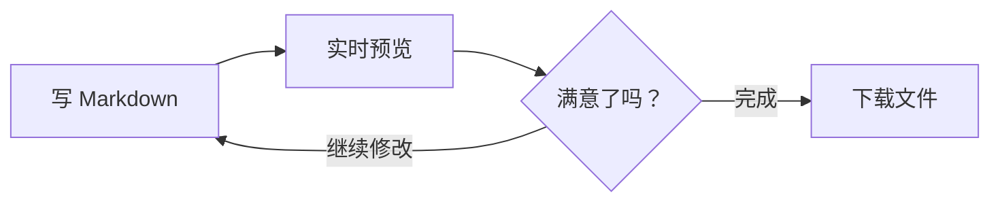
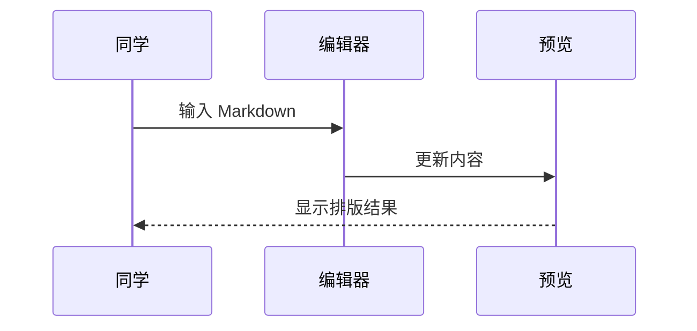

# 从这里，开始 Markdown

用纯文本，写出有结构的内容。


这是一份可以直接修改的语法实验册。左边写源码，右边看结果。试着把这一句改成自己的介绍，再往下探索。

想试试代码调试？打开 [调试入门](./调试入门.md)，从五个十几行的小程序开始。

## 目录

- [标题与段落](#标题与段落)
- [文字样式](#文字样式)
- [引用](#引用)
- [列表与任务](#列表与任务)
- [链接与图片](#链接与图片)
- [代码](#代码)
- [表格](#表格)
- [分隔线与转义](#分隔线与转义)
- [LaTeX 数学公式](#latex-数学公式)
- [Mermaid 图表](#mermaid-图表)
- [HTML 与折叠内容](#html-与折叠内容)
- [注释与补充语法](#注释与补充语法)
- [动手练习](#动手练习)

## 标题与段落

标题用 `#` 开头，符号后加一个空格，一共有六级。文档开头已经使用了一级标题；本节标题是二级。

### 三级标题
#### 四级标题
##### 五级标题
###### 六级标题

还有一种标题写法：

另一种二级标题
----------------

```markdown
另一种一级标题
===============

另一种二级标题
---------------
```

空一行，就会产生新的段落。

这是另一个段落。
源码里只按一次回车，通常仍然属于同一段。

这一行末尾有两个空格，因此会换行。  
这是换行后的第二行。

这一行以反斜杠结束，也会换行。\
这是下一行。

## 文字样式

*星号斜体*，_下划线斜体_。

**星号粗体**，__下划线粗体__。

***粗体与斜体***，**粗体里面有 _斜体_**。

~~删除线~~，以及普通文字。

行内代码：`print("Hello, Markdown!")`。

需要在行内代码里写反引号时，用两个反引号包住：`` `code` ``。

## 引用

> 你可以用引用记录一句话。
>
> 引用也能有多个段落，以及 **强调** 和 `代码`。
>
> > 这是嵌套引用。

> ### 引用里的小标题
>
> - 第一条想法
> - 第二条想法

## 列表与任务

### 无序列表

- 阅读题目
- 整理思路
  - 写下已知条件
  - 列出待解决的问题
- 开始动笔

星号和加号也能作为列表标记：

* 使用星号
* 第二项

+ 使用加号
+ 第二项

### 有序列表

1. 新建一个 `.md` 文件。
2. 输入内容。
   1. 先写标题。
   2. 再写正文。
3. 打开预览。

序号可以从指定数字开始：

7. 这是第七项。
8. 这是第八项。

### 任务列表

`[x]` 表示已完成，`[ ]` 表示待办。这是常见的扩展语法；原生 VS Code 预览保留文字标记，GitHub 等工具会显示成复选框。

- [x] 打开这份文档
- [x] 看见预览中的图片
- [ ] 修改一个标题
- [ ] 写一个自己的公式
- [ ] 下载练习目录

### 列表里的段落和代码

1. 一个列表项可以包含多个段落。

   后续段落需要缩进，让它继续属于这一项。

   ```python
   message = "Markdown is plain text."
   print(message)
   ```

2. 接着开始下一个列表项。

## 链接与图片

### 链接

[VS Code 的 Markdown 文档](https://code.visualstudio.com/docs/languages/markdown)

[带有悬停标题的链接](https://www.nju.edu.cn/ "南京大学")

[打开同目录内的另一份文档](./notes/链接目标.md)

[直接跳到另一份文档中的标题](./notes/链接目标.md#实验记录)

[跳到本文的数学公式部分](#latex-数学公式)

自动链接：<https://www.nju.edu.cn/>，<student@example.com>。

引用式链接：[南京大学][nju]、[VS Code][vscode]。

简写引用式链接：[南京大学]。

[nju]: https://www.nju.edu.cn/ "南京大学"
[vscode]: https://code.visualstudio.com/
[南京大学]: https://www.nju.edu.cn/

### 本地图片

图片语法就是在链接前加 `!`。方括号中的文字是替代文本；相对路径从当前文档所在目录开始计算。


图片也可以使用引用式写法：

![远山][landscape]

[landscape]: ./assets/山间日出.svg "山间日出"

让图片变成可点击的链接：

[](./notes/链接目标.md)

用 HTML 控制图片宽度：


### 附属文件

[课程安排（CSV）](./data/课程安排.csv) · [参考信息（JSON）](./data/参考信息.json)

## 代码

### 围栏代码块

三个反引号后面可以写语言名，预览会按语言高亮。

```python
def greet(name: str) -> str:
    return f"你好，{name}！"

print(greet("Markdown"))
```

```javascript
const squares = [1, 2, 3, 4].map(n => n ** 2);
console.log(squares); // [1, 4, 9, 16]
```

```cpp
#include <iostream>

int main() {
    std::cout << "Hello, Markdown!" << std::endl;
    return 0;
}
```

```json
{
  "course": "Markdown 入门",
  "installed": false,
  "topics": ["文字", "图片", "公式"]
}
```

波浪线也可以围成代码块：

~~~html
<strong>这段 HTML 作为代码显示，不会执行。</strong>
~~~

想展示包含三个反引号的源码，可以在外层使用四个：

````markdown
```python
print("嵌套代码围栏")
```
````

### 缩进代码块

下面每行前面有四个空格：

    这是缩进代码块。
    **这里不会变成粗体。**

## 表格

冒号决定对齐方向：左侧、两侧、右侧分别对应左对齐、居中、右对齐。

| 项目 | 状态 | 数量 |
| :--- | :---: | ---: |
| Markdown 文档 | **就绪** | 3 |
| 本地图片 | 就绪 | 2 |
| 公式示例 | 就绪 | 10 |
| 含有竖线 `a\|b` 的内容 | 支持转义 | 1 |

单元格里可以放 [链接](./notes/链接目标.md)、*斜体*、`行内代码` 和 $x^2$。

## 分隔线与转义

下面是一条分隔线：

---

也可以使用三个星号或下划线：

***

___

反斜杠让特殊符号按原样显示：

\*这不是斜体\*，\# 这不是标题，\[这不是链接\]。

HTML 实体：&copy; &amp; &lt; &gt; &nbsp; &rarr;。

## LaTeX 数学公式

行内公式放在一对美元符号之间，例如 $E = mc^2$，或者 $a^2+b^2=c^2$。

独立公式放在两对美元符号之间。VS Code 的内置数学扩展使用 KaTeX 渲染 LaTeX 数学语法。

### 分数、根号与上下标

$$
x_{1,2} = \frac{-b \pm \sqrt{b^2 - 4ac}}{2a}
$$

### 求和与乘积

$$
\sum_{k=1}^{n} k = \frac{n(n+1)}{2},
\qquad \prod_{k=1}^{n} k = n!
$$

### 积分与极限

$$
\int_0^1 x^2\,\mathrm{d}x = \frac{1}{3},
\qquad \lim_{n\to\infty}\left(1+\frac{1}{n}\right)^n = e
$$

### 矩阵

$$
A = \begin{bmatrix}
1 & 2 & 3 \\
4 & 5 & 6 \\
7 & 8 & 9
\end{bmatrix},
\qquad
\det\begin{pmatrix}a&b\\c&d\end{pmatrix} = ad-bc
$$

### 分段函数

$$
|x| = \begin{cases}
x, & x \ge 0, \\
-x, & x < 0.
\end{cases}
$$

### 多行对齐

$$
\begin{aligned}
(a+b)^2 &= (a+b)(a+b) \\
        &= a^2 + 2ab + b^2
\end{aligned}
$$

### 向量与微分

$$
\mathbf{v} = \begin{pmatrix}v_1\\v_2\\v_3\end{pmatrix},
\qquad \nabla f = \left(\frac{\partial f}{\partial x},\frac{\partial f}{\partial y}\right)
$$

### 集合与逻辑

$$
A \cap B \subseteq A \cup B,
\qquad \forall x \in \mathbb{R},\; x^2 \ge 0
$$

### 概率与期望

$$
P(A\mid B) = \frac{P(B\mid A)P(A)}{P(B)},
\qquad \mathbb{E}[X] = \sum_i x_i p_i
$$

### 希腊字母、装饰与文字

$$
\alpha + \beta = \gamma,
\quad \hat{\theta},\;\bar{x},\;\vec{v},\;\overbrace{a+\cdots+a}^{n\text{ 项}}=na
$$

也可以使用标记为 `math` 的围栏代码块：

```math
\boxed{e^{i\pi}+1=0}
```

## Mermaid 图表

内置 Mermaid 扩展可以把文字描述变成图表。





## HTML 与折叠内容

<details>
<summary>点击展开：一段隐藏的内容</summary>

这里仍然可以使用 **Markdown**。HTML 标签与 Markdown 段落之间留一个空行。

- 一条列表项
- 一条带公式的列表项：$a+b=c$

</details>

使用 `<kbd>` 表示按键：<kbd>Ctrl</kbd> + <kbd>Shift</kbd> + <kbd>V</kbd>。

上标与下标：H<sub>2</sub>O，x<sup>2</sup>。<mark>标记文字</mark>，<s>删除文字</s>。

这是第一行。<br>这是通过 HTML 换行的第二行。

<dl>
  <dt>Markdown</dt>
  <dd>一种轻量级标记语言。</dd>
  <dt>相对路径</dt>
  <dd>从当前文档出发找到另一个文件的路径。</dd>
</dl>

## 注释与补充语法

<!-- 这是一条 HTML 注释，只在源码中可见。 -->

上面有一条只在源码里出现的注释。

Markdown 有不同方言。这份文档演示本工作台内置的 VS Code Markdown、数学和 Mermaid 功能。脚注、定义列表、自动目录、`==高亮==`、`:emoji:` 短代码等是否生效，取决于所用扩展；它们不是所有 Markdown 解析器都支持的语法。普通 Unicode 表情可以直接输入：🌱 ✨ ✅。

需要脚注效果时，可以使用 HTML 锚点：这一句有一个脚注<sup><a href="#footnote-1">[1]</a></sup>。

<p id="footnote-1">[1] 这是通过 HTML 编写的脚注内容。</p>

YAML 元数据示例放在 [元数据示例.md](./notes/元数据示例.md) 中。它位于文件开头，是否特殊显示由预览设置决定。

## 动手练习

1. 把本文的一级标题换成你喜欢的标题。
2. 为自己列出三条待办事项。
3. 在 `assets` 目录中导入一张图片，再用相对路径插入。
4. 写下一个数学公式，并改变其中的参数。
5. 修改附属文档中的标题，体验链接补全和标题导航。
6. 用“文件 → 下载整个练习目录”把成果带走。

### 常用操作

| 操作 | Windows / Linux |
| :--- | :--- |
| 命令面板 | `F1` 或 `Ctrl+Shift+P` |
| 打开 Markdown 预览 | `Ctrl+Shift+V` |
| 在右侧打开预览 | 先按 `Ctrl+K`，再按 `V` |
| 查找 / 替换 | `Ctrl+F` / `Ctrl+H` |
| 跳到标题 | `Ctrl+Shift+O` |
| 快速打开文件 | `Ctrl+P` |
| 保存到浏览器工作区 | `Ctrl+S` |
| 下载当前文件 | `Ctrl+Shift+S` |
| 导入本地文件 | `Ctrl+O` |
| 显示 / 隐藏侧栏 | `Ctrl+B` |
| 自动换行 | `Alt+Z` |

Mac 上多数 `Ctrl` 快捷键对应 `⌘`；具体以命令面板显示的快捷键为准。浏览器可能占用部分组合键，可以直接使用菜单或 `F1`。

工作内容自动保存在当前浏览器中。清除网站数据会清除练习文件；下载整个目录可以保留图片和文档的相对路径。
